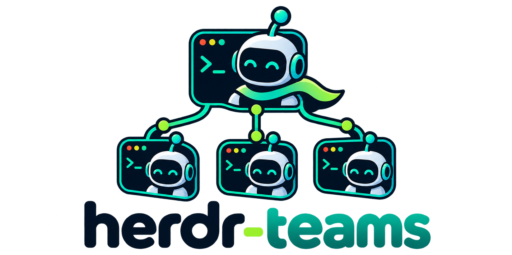

# herdr-teams



> ⚠️ **Work in progress.** Not ready for use.

A [herdr](https://github.com/ogulcancelik/herdr) plugin for running a team of
coding agents. A lead agent spawns persistent, named teammates (Claude Code,
Codex, pi, …), each in its own herdr pane with its own model and thinking level.

- **Task board:** a shared board with statuses and dependencies.
- **Inboxes:** direct messages, broadcasts and reports to the lead, delivered
  when an agent is idle.
- **Git worktrees:** isolated checkouts for parallel work, managed by the lead.
- **Plan mode and quality gates:** plans before code, and hooks that can reject
  a task's completion.
- **Live supervision:** stall warnings, plus steering, interrupting or stopping
  a running agent.

See [docs/PLAN.md](docs/PLAN.md) for the design.

## Development

Requires Node.js ≥ 20 and npm. M1 implements persistent teams, tasks with
dependencies and exclusive claiming, inboxes, and an event log. M2 adds spawning, labels, bootstrap, shutdown and kill. M3 adds idle inbox
delivery, event hooks, turn reports, auto-claim and restart reconciliation.
M4 adds the supervisor, progress advisories and correction commands. M8 adds the terminal board, status, logs and sidebar labels.

```sh
npm ci
npm run build
npm test
npm run lint
npm run typecheck
./bin/herdr-teams --help
./bin/herdr-teams --team demo --json task list
```

With herdr ≥ 0.9.5 installed, build first, then run:

```sh
herdr plugin link .
herdr plugin action invoke herdr-teams.start-team
```

Linking does not build. Invoking an action requires a running herdr session.
The shim at `bin/herdr-teams` loads `dist/bin/herdr-teams.js`. Tests use a
scripted fake herdr executable; no agents or API keys are needed.

## Core CLI

```sh
export HERDR_TEAMS_HOME="$PWD/.teams-state"
./bin/herdr-teams team create demo --lead lead
export HERDR_TEAMS_TEAM=demo
./bin/herdr-teams task add "Implement authentication" --description "Add login"
./bin/herdr-teams task claim 1
./bin/herdr-teams task complete 1 --result "Login implemented"
./bin/herdr-teams msg send lead "Ready for review"
./bin/herdr-teams inbox
```

`task dep add <task> <prerequisite>` blocks claims until the prerequisite is
completed. `task assign`, `task release`, dependency edits and task edits are
restricted to the lead or a user outside a member pane. `task update` accepts
`--subject` and `--description`; `task complete` accepts `--result`.
`team list`, `task list`, `task show`, `broadcast` and `report` are also available.
Core commands currently print JSON, including when `--json` is omitted.
Messages are persisted and delivered in batches when recipients are idle.
Blocked recipients retain their mail. A message body is limited to 32 KiB;
send a file path for anything larger. Large backlogs arrive over several
prompts. Only the lead or user may send `--urgent` mail, which steers a working
Codex agent; other kinds use interrupt-then-idle delivery. Set `auto_claim: false` in team config
to disable automatic claiming. Generated state belongs outside the repository
or in an ignored directory.

## Teammates

herdr does not put plugin commands on PATH, so install the CLI for the lead once
(see [Installation and support](#installation-and-support)). Inside a herdr
session, create a team from the lead pane, then spawn members:

```sh
herdr plugin action invoke herdr-teams.install-shim
herdr-teams team create demo
herdr-teams --team demo spawn alice --kind codex --thinking high --prompt "Review the implementation"
herdr-teams --team demo shutdown alice
```

Inside herdr, team state defaults to herdr's plugin state directory, the one
its startup and event hooks read; leave `HERDR_TEAMS_HOME` unset there. A team
belongs to the herdr session it was created in: commands and hooks from other
sessions leave it alone. Members receive team identity and the CLI on PATH. Splits use team tabs with
four teammates per tab; `--placement tab|workspace` gives a member its own
location. All panes open without taking focus. `--model` and `--thinking`
override team defaults. Use `--worktree dedicated` for an isolated checkout, or `auto` to start shared.

A shutdown request waits for the member to accept or reject it. Accepted requests
exit the CLI when idle and close the pane only after exit is observed. `done`
requests shutdown for all teammates, refusing active tasks; `done --force` and
`kill <name>` close panes and return active tasks to pending. Launch failures
retain the pane and send the lead arguments and recent output.

## Supervision

The supervisor opens after team creation and reopens on herdr startup. Set
`supervisor.mode` to `off` to use event hooks alone, or `tab` for a separate
system tab. Defaults are a 30-second tick, a 10-minute no-progress advisory,
a 2-minute needs-input advisory and a 5-minute unknown-state advisory. Set a
threshold to zero to disable it. Advisories inform the lead; they do not kill
or restart teammates. Interactive or recently focused members stay quiet.

```sh
herdr-teams --team demo peek alice --lines 40
herdr-teams --team demo steer alice "Focus on the failing test"
herdr-teams --team demo interrupt alice --then "Summarize your current work"
herdr-teams --team demo task release 1 --reason "Reassigning the task"
```

Only the lead or user may steer, interrupt, release or kill. Blocked agents must have
their permission or question prompt answered before those input operations.

## Worktrees

```sh
herdr-teams --team demo worktree create alice
herdr-teams --team demo worktree status alice
herdr-teams --team demo worktree diff alice
herdr-teams --team demo worktree merge alice
herdr-teams --team demo worktree remove alice
```

Only the lead or user creates, merges and removes worktrees. Teammates can
`worktree request --reason "…"`; the lead uses `worktree approve <id>`.
`worktree_requests: auto` approves requests immediately. `task add --worktree`
requires an isolated checkout when claimed. Creation pins a committed base;
uncommitted changes in the lead checkout stay there.

Completion reports include branch, base, head, commit count and checkout state.
Merge requires clean checkouts and runs only on an explicit command. Removal
requires no running agent, a clean checkout and a branch merged into the lead's
HEAD. `--preserve` commits dirty files first, `--force-unmerged` keeps an unmerged
branch, and `--delete-branch` explicitly removes the branch. `cleanup` lists
ended members' worktrees; `cleanup --apply` removes only eligible ones.

## Plans and quality gates

```sh
herdr-teams --team demo task add "Implement login" --plan-mode --gate "npm test"
herdr-teams --team demo plan submit 1 --file plan.md
herdr-teams --team demo plan approve 1
herdr-teams --team demo plan reject 1 --feedback "Add failure tests"
```

The active owner submits a versioned plan; only the lead or user approves or
rejects it. `plan_approval: none` lets the owner continue after submitting.
Late verdicts are recorded without reopening terminal tasks.

Executable hooks in `.herdr/teams/hooks/` override global hooks in
`~/.config/herdr-teams/hooks/`. Names are `task_created`, `task_completed`,
`plan_submitted` and `teammate_idle`. They receive JSON on stdin and team,
member and task identity in `HERDR_TEAMS_*` variables. Completion gates run
first, in the task's worktree. Exit 2 rejects an action with feedback; other
failures retain the open task and apply `hooks.failure_action` (`warn`,
`reopen`, `followup` or `reopen_followup`). `max_reopens` defaults to 3 and
`followup_owner` to `member`. Hook timeouts default to 600 seconds.
Existing `.pi/team-hooks/task_completed.sh` hooks also run with JSON as their
first argument and `PI_TEAM` set.

## Templates and agent definitions

Put reusable roles in `.herdr/agents/<name>.md` with YAML frontmatter and a
markdown instruction body. Project `.herdr/` definitions take precedence over
`.pi/agents/`, `.claude/agents/` and global definitions in
`~/.config/herdr-teams/agents/`.

```yaml
---
kind: codex
thinking: high
worktree: shared
---
Review changes and report defects with file and line references.
```

Define teams in `.herdr/teams.yaml` or `~/.config/herdr-teams/teams.yaml`:

```yaml
review:
  defaults: { kind: codex, thinking: medium }
  supervisor: { mode: pane }
  members:
    - { name: alice, agent: reviewer }
  tasks:
    - { subject: Review the implementation, owner: alice }
```

A short form such as `review: [reviewer]` also works. Explicit spawn flags
override definitions, then team defaults, then lead defaults. Unknown
frontmatter keys are ignored. Seed-task owner `$lead` refers to the runtime
lead name.

```sh
herdr-teams team start review --name review-session
herdr-teams --team review-session team save saved-review --scope project
herdr-teams spawn alice --agent reviewer --model <model> --prompt "Review tests"
```

Saving exports role definitions and seed tasks, without pane IDs or task run
state. A failed start retains its team and launch records for inspection.

## Board and logs

```sh
herdr-teams --team demo board
herdr-teams --team demo board --once
herdr-teams --team demo status --json
herdr-teams --team demo log --follow
```

The board shows status columns, members, time in state, unread mail, dependencies,
branches and recent lead messages. Tab switches between tasks and members;
j/k selects. Enter peeks; m sends a message; u steers; i interrupts; r releases;
a assigns; o reopens; p approves a plan; n rejects with feedback; x kills; q exits.
Actions use the CLI's usual permission and blocked-agent checks.

The supervisor updates member labels and workspace progress tokens. Closing the
supervisor leaves event hooks active and shows it as offline on the board.

## MCP

`herdr-teams mcp` serves JSON-RPC MCP tools over stdio. Configure your MCP
client to run the built shim with the same `HERDR_TEAMS_HOME`,
`HERDR_TEAMS_TEAM`, `HERDR_TEAMS_AGENT` and herdr environment as the CLI.
Tools use CLI argument arrays, preserving member identity and authorization.
Long-running terminal commands are available through the CLI only.

```json
{
  "mcpServers": {
    "herdr-teams": {
      "command": "herdr-teams",
      "args": ["mcp"],
      "env": {
        "HERDR_TEAMS_HOME": "<state-directory>",
        "HERDR_TEAMS_TEAM": "<team>",
        "HERDR_TEAMS_AGENT": "<member>"
      }
    }
  }
}
```

## Installation and support

Once the feature PRs are merged, install with
`herdr plugin install sonhal/herdr-teams`. The manifest runs `npm ci` and builds
TypeScript. Development checkouts use `herdr plugin link .` after building.
`herdr plugin action invoke herdr-teams.install-shim` installs a `herdr-teams`
launcher in `~/.local/bin` for the lead and reports the result as a herdr
notification; `herdr-teams install-shim --directory <directory-on-PATH>` picks
another directory. The launcher asks herdr for the installed plugin on each
run, so it keeps working after `herdr plugin update`. It replaces only its own
earlier launcher or link, never another file.

Linux and macOS are the supported runtime platforms. Windows CI checks build
and CLI help only; Windows panes, signals and Unix sockets are not supported.
Codex launch flags and fake-herdr contracts are tested. Claude and pi mappings
remain untested here. OpenCode supports its documented model flag and exit
command; explicit thinking effort is refused because no TUI launch mapping is
verified. Live herdr latency and interactive board UX still need manual checks.
