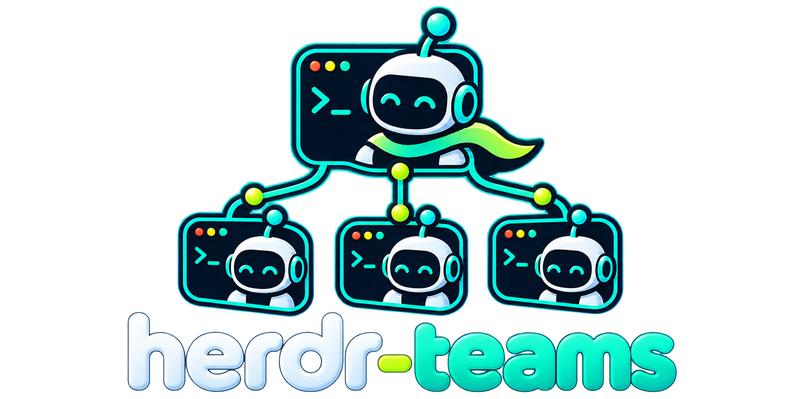

# herdr-teams



> ⚠️ **Work in progress.** Not ready for use.

A [herdr](https://github.com/ogulcancelik/herdr) plugin for running teams of
coding agents. A lead coordinates persistent, named teammates in their own
terminal panes, using a shared task board and inboxes. Teams can mix Claude
Code, Codex, pi and OpenCode, with optional Git worktrees, plans and completion
gates.

## Install

Requires Linux or macOS, herdr ≥ 0.9.5, Node.js ≥ 20, npm and the coding-agent
CLIs you want to run, installed and authenticated.

```sh
herdr plugin install sonhal/herdr-teams
herdr plugin action invoke herdr-teams.install-shim
```

The installer builds the plugin. The second command installs a launcher in
`~/.local/bin`; make sure that directory is on your `PATH`.

Run team commands from your project's directory in a running herdr session,
in the pane that will lead the team. Leave `HERDR_TEAMS_HOME` unset so commands
and event hooks use the same state directory.

## Start a team from a template

```sh
herdr-teams team templates
herdr-teams team start dev --name app --kind codex
herdr-teams --team app task add "Implement authentication"
herdr-teams --team app board
```

The built-in `dev` template has a developer, reviewer and tester.
`research` has two researchers and a synthesizer. Omit `--kind` to use the
agent running in the lead pane, or choose `claude`, `codex`, `pi` or
`opencode`. Roles that specify a kind keep their choice.

Starting a team returns its UUID and display name. Use `--team <id>` or set
`HERDR_TEAMS_TEAM` to that UUID for later commands. A unique display name
also works, as in these examples; use the UUID if names repeat.

## Create your own templates

Put team templates in `.herdr/teams.yaml` in your project, or in
`~/.config/herdr-teams/teams.yaml` to share them across projects:

```yaml
review:
  defaults: { kind: codex, thinking: medium }
  members:
    - { name: alice, agent: reviewer }
  tasks:
    - { subject: Review the implementation, owner: alice }
```

`reviewer` is a built-in role. To create a role, add a Markdown file such as
`.herdr/agents/security-reviewer.md` and use `agent: security-reviewer`:

```markdown
---
kind: codex
thinking: high
worktree: shared
---
Review changes for security defects. Report findings with file and line references.
```

Start your template, or save an existing team for reuse:

```sh
herdr-teams team start review --name review-session
herdr-teams --team review-session team save saved-review --scope project
```

See [template resolution and saving](docs/usage.md#templates-and-agent-definitions)
for defaults, global roles and configuration precedence.

## Create a team without a template

```sh
herdr-teams team create demo
herdr-teams --team demo spawn alice --kind codex --prompt "Review the implementation"
herdr-teams --team demo spawn bob --kind claude --worktree dedicated --prompt "Implement login"
herdr-teams --team demo task add "Implement login"
herdr-teams --team demo msg send bob "Coordinate the login work with alice"
herdr-teams --team demo status
```

Teammates share the lead's checkout by default. Use `--worktree dedicated`
for an isolated branch and checkout. Review and merge it explicitly with
`worktree diff <member>` and `worktree merge <member>`.
Messages are delivered when recipients are idle; the board is optional.

## Shut down a team

```sh
herdr-teams --team demo done
```

`done` refuses while tasks are active and requests shutdown for all teammates.
Members may accept or reject; accepted requests close panes after the agent
exits. Check `status` for pending shutdowns.

To request one member's shutdown, run `shutdown alice`. To stop immediately,
`done --force` stops all remaining teammates, or `kill alice` stops one;
both return their active tasks to pending. Worktrees are kept for review.
`cleanup` lists ended members' worktrees, and `cleanup --apply` removes only
those eligible for safe removal.

## Develop

```sh
npm ci
npm run build
npm test
npm run lint
npm run typecheck
herdr plugin link .
```

Linking uses your local build. See [development](docs/development.md) for live
herdr tests, the code map and contribution rules.

The plugin uses **TypeScript and Node.js**, **Commander** for its CLI,
**YAML and Markdown** for templates and roles, and local **JSON files** for
state. **herdr** supplies terminal panes, agent control, events and worktrees.
Checks use **Vitest, ESLint and Prettier**.

For task commands, inboxes, team control, worktree safeguards, plans, hooks,
board keys and support limitations, see the [usage reference](docs/usage.md).
